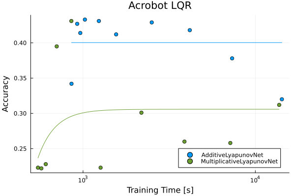
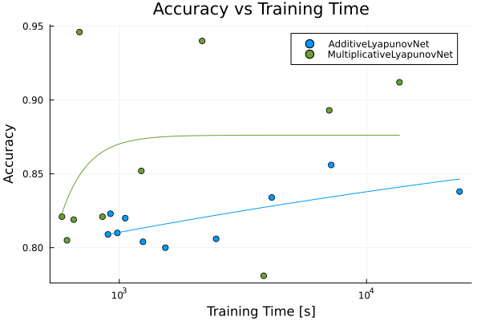
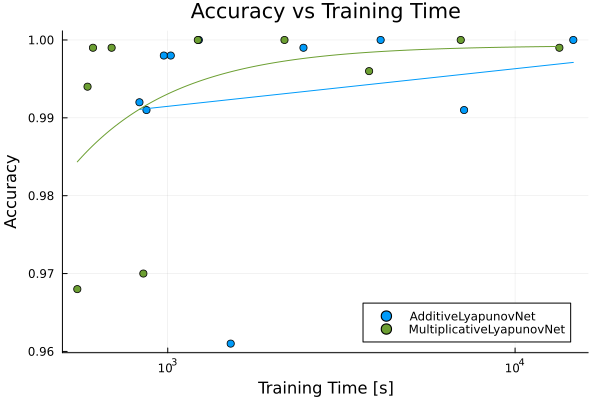
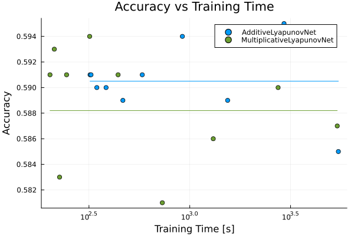
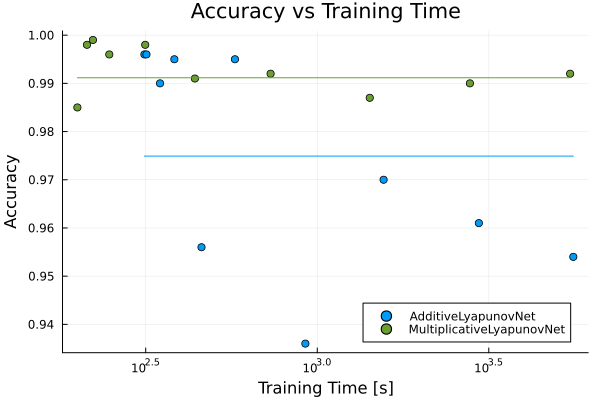
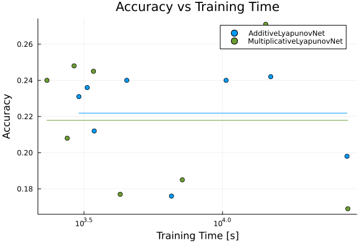
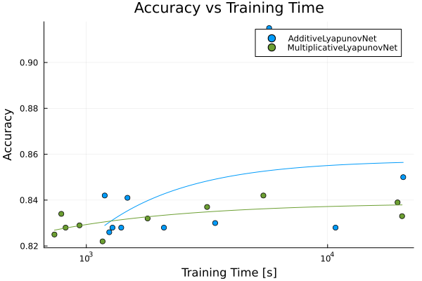

# lyapunov-net_variants Summary

## Accuracy vs Training Time Plots

|  |  |  |
| --- | --- | --- |
|  Acrobot LQR |  Double Pendulum LQR |  Double Pendulum Undriven |
|  Pendulum Controlled |  Pendulum Undriven |  Quadrotor 3D LQR |
|  Quadrotor Planar LQR |  |  |

## Accuracy Fit Parameters

$$\mathrm{Accuracy}(t) = A - C \cdot t^{-p}, \quad A, C, p \geq 0, \quad t = \mathrm{Training\ Time}.$$

| System | Architecture | Asymptotic Value | Coefficient | Power |
| --- | --- | --- | --- | --- |
| Acrobot LQR | AdditiveLyapunovNet | 0.4003999999996338 | 2.6681438488165814e-10 | 6.113582006002467 |
| Acrobot LQR | MultiplicativeLyapunovNet | 0.3058369411653843 | 4.9756323351696945e10 | 4.329899974686114 |
| Double Pendulum LQR | AdditiveLyapunovNet | 0.9317917482514808 | 0.26232833853248544 | 0.11153882571330738 |
| Double Pendulum LQR | MultiplicativeLyapunovNet | 0.8761999289051461 | 1.1314024140857925e10 | 4.092926832170518 |
| Double Pendulum Undriven | AdditiveLyapunovNet | 3.8032836713249845 | 2.826358359658923 | 0.0007472299735906307 |
| Double Pendulum Undriven | MultiplicativeLyapunovNet | 0.9993135679388451 | 146.68203351714516 | 1.4568781082597728 |
| Pendulum Controlled | AdditiveLyapunovNet | 0.5904999999872178 | 8.962096126988332 | 5.636136910515729 |
| Pendulum Controlled | MultiplicativeLyapunovNet | 0.5882021054324105 | 0.0 | 1.3433430036386134 |
| Pendulum Undriven | AdditiveLyapunovNet | 0.9748999999995746 | 0.0 | 4.821452888188091 |
| Pendulum Undriven | MultiplicativeLyapunovNet | 0.9911618633145726 | 0.0 | 1.422371420205503 |
| Quadrotor 3D LQR | AdditiveLyapunovNet | 0.22187500000070834 | 138.25363669773785 | 3.9573107532861065 |
| Quadrotor 3D LQR | MultiplicativeLyapunovNet | 0.21787499999962334 | 115.26942661146 | 20.839766462948017 |
| Quadrotor Planar LQR | AdditiveLyapunovNet | 0.8574577504098264 | 109.39826698507116 | 1.1650435902614982 |
| Quadrotor Planar LQR | MultiplicativeLyapunovNet | 0.8389227576356759 | 1.6494564314548468 | 0.7452524211219516 |

## Trial Summary

| System | Architecture | N | True Positives | False Positives | True Negatives | False Negatives | Accuracy | Training Time |
| --- | --- | --- | --- | --- | --- | --- | --- | --- |
| Acrobot LQR | AdditiveLyapunovNet | 10 | 42.0 | 542.0 | 389.0 | 27.0 | 0.431 | 1235.994957785 |
| Acrobot LQR | AdditiveLyapunovNet | 11 | 33.0 | 552.0 | 379.0 | 36.0 | 0.412 | 1556.351314742 |
| Acrobot LQR | AdditiveLyapunovNet | 12 | 42.0 | 544.0 | 387.0 | 27.0 | 0.429 | 2504.836800472 |
| Acrobot LQR | AdditiveLyapunovNet | 13 | 42.0 | 555.0 | 376.0 | 27.0 | 0.418 | 4164.114043328 |
| Acrobot LQR | AdditiveLyapunovNet | 14 | 35.0 | 588.0 | 343.0 | 34.0 | 0.378 | 7333.667687344 |
| Acrobot LQR | AdditiveLyapunovNet | 15 | 43.0 | 654.0 | 277.0 | 26.0 | 0.32 | 14259.804712307 |
| Acrobot LQR | AdditiveLyapunovNet | 6 | 40.0 | 629.0 | 302.0 | 29.0 | 0.342 | 857.191366162 |
| Acrobot LQR | AdditiveLyapunovNet | 7 | 42.0 | 546.0 | 385.0 | 27.0 | 0.427 | 924.8516392 |
| Acrobot LQR | AdditiveLyapunovNet | 8 | 44.0 | 561.0 | 370.0 | 25.0 | 0.414 | 963.896530109 |
| Acrobot LQR | AdditiveLyapunovNet | 9 | 43.0 | 541.0 | 390.0 | 26.0 | 0.433 | 1025.154803843 |
| Acrobot LQR | MultiplicativeLyapunovNet | 10 | 42.0 | 542.0 | 389.0 | 27.0 | 0.431 | 855.706624703 |
| Acrobot LQR | MultiplicativeLyapunovNet | 11 | 51.0 | 759.0 | 172.0 | 18.0 | 0.223 | 1264.579673873 |
| Acrobot LQR | MultiplicativeLyapunovNet | 12 | 48.0 | 678.0 | 253.0 | 21.0 | 0.301 | 2181.77566581 |
| Acrobot LQR | MultiplicativeLyapunovNet | 13 | 44.0 | 715.0 | 216.0 | 25.0 | 0.26 | 3878.879675074 |
| Acrobot LQR | MultiplicativeLyapunovNet | 14 | 46.0 | 719.0 | 212.0 | 23.0 | 0.258 | 7159.700893663 |
| Acrobot LQR | MultiplicativeLyapunovNet | 15 | 48.0 | 667.0 | 264.0 | 21.0 | 0.312 | 13754.846739117 |
| Acrobot LQR | MultiplicativeLyapunovNet | 6 | 53.0 | 761.0 | 170.0 | 16.0 | 0.223 | 547.69423342 |
| Acrobot LQR | MultiplicativeLyapunovNet | 7 | 43.0 | 752.0 | 179.0 | 26.0 | 0.222 | 572.972979401 |
| Acrobot LQR | MultiplicativeLyapunovNet | 8 | 50.0 | 753.0 | 178.0 | 19.0 | 0.228 | 607.477926048 |
| Acrobot LQR | MultiplicativeLyapunovNet | 9 | 47.0 | 583.0 | 348.0 | 22.0 | 0.395 | 703.496619678 |
| Double Pendulum LQR | AdditiveLyapunovNet | 10 | 804.0 | 0.0 | 0.0 | 196.0 | 0.804 | 1246.841866402 |
| Double Pendulum LQR | AdditiveLyapunovNet | 11 | 800.0 | 0.0 | 0.0 | 200.0 | 0.8 | 1535.93260528 |
| Double Pendulum LQR | AdditiveLyapunovNet | 12 | 806.0 | 0.0 | 0.0 | 194.0 | 0.806 | 2464.283952205 |
| Double Pendulum LQR | AdditiveLyapunovNet | 13 | 834.0 | 0.0 | 0.0 | 166.0 | 0.834 | 4137.147248734 |
| Double Pendulum LQR | AdditiveLyapunovNet | 14 | 856.0 | 0.0 | 0.0 | 144.0 | 0.856 | 7197.813505308 |
| Double Pendulum LQR | AdditiveLyapunovNet | 15 | 838.0 | 0.0 | 0.0 | 162.0 | 0.838 | 23798.722758984 |
| Double Pendulum LQR | AdditiveLyapunovNet | 6 | 809.0 | 0.0 | 0.0 | 191.0 | 0.809 | 899.755520569 |
| Double Pendulum LQR | AdditiveLyapunovNet | 7 | 823.0 | 0.0 | 0.0 | 177.0 | 0.823 | 921.086801692 |
| Double Pendulum LQR | AdditiveLyapunovNet | 8 | 810.0 | 0.0 | 0.0 | 190.0 | 0.81 | 981.971322007 |
| Double Pendulum LQR | AdditiveLyapunovNet | 9 | 820.0 | 0.0 | 0.0 | 180.0 | 0.82 | 1056.675679216 |
| Double Pendulum LQR | MultiplicativeLyapunovNet | 10 | 821.0 | 0.0 | 0.0 | 179.0 | 0.821 | 854.836366916 |
| Double Pendulum LQR | MultiplicativeLyapunovNet | 11 | 852.0 | 0.0 | 0.0 | 148.0 | 0.852 | 1227.605356604 |
| Double Pendulum LQR | MultiplicativeLyapunovNet | 12 | 940.0 | 0.0 | 0.0 | 60.0 | 0.94 | 2163.109935939 |
| Double Pendulum LQR | MultiplicativeLyapunovNet | 13 | 781.0 | 0.0 | 0.0 | 219.0 | 0.781 | 3838.404591123 |
| Double Pendulum LQR | MultiplicativeLyapunovNet | 14 | 893.0 | 0.0 | 0.0 | 107.0 | 0.893 | 7067.176352128 |
| Double Pendulum LQR | MultiplicativeLyapunovNet | 15 | 912.0 | 0.0 | 0.0 | 88.0 | 0.912 | 13590.542724879 |
| Double Pendulum LQR | MultiplicativeLyapunovNet | 6 | 821.0 | 0.0 | 0.0 | 179.0 | 0.821 | 586.07592291 |
| Double Pendulum LQR | MultiplicativeLyapunovNet | 7 | 805.0 | 0.0 | 0.0 | 195.0 | 0.805 | 614.208850619 |
| Double Pendulum LQR | MultiplicativeLyapunovNet | 8 | 819.0 | 0.0 | 0.0 | 181.0 | 0.819 | 653.927905081 |
| Double Pendulum LQR | MultiplicativeLyapunovNet | 9 | 946.0 | 0.0 | 0.0 | 54.0 | 0.946 | 690.281283323 |
| Double Pendulum Undriven | AdditiveLyapunovNet | 10 | 1000.0 | 0.0 | 0.0 | 0.0 | 1.0 | 1228.756967199 |
| Double Pendulum Undriven | AdditiveLyapunovNet | 11 | 961.0 | 0.0 | 0.0 | 39.0 | 0.961 | 1517.877224882 |
| Double Pendulum Undriven | AdditiveLyapunovNet | 12 | 999.0 | 0.0 | 0.0 | 1.0 | 0.999 | 2458.907342959 |
| Double Pendulum Undriven | AdditiveLyapunovNet | 13 | 1000.0 | 0.0 | 0.0 | 0.0 | 1.0 | 4101.166463159 |
| Double Pendulum Undriven | AdditiveLyapunovNet | 14 | 991.0 | 0.0 | 0.0 | 9.0 | 0.991 | 7131.001417967 |
| Double Pendulum Undriven | AdditiveLyapunovNet | 15 | 1000.0 | 0.0 | 0.0 | 0.0 | 1.0 | 14710.338235962 |
| Double Pendulum Undriven | AdditiveLyapunovNet | 6 | 992.0 | 0.0 | 0.0 | 8.0 | 0.992 | 828.92796164 |
| Double Pendulum Undriven | AdditiveLyapunovNet | 7 | 991.0 | 0.0 | 0.0 | 9.0 | 0.991 | 868.445326634 |
| Double Pendulum Undriven | AdditiveLyapunovNet | 8 | 998.0 | 0.0 | 0.0 | 2.0 | 0.998 | 974.553813732 |
| Double Pendulum Undriven | AdditiveLyapunovNet | 9 | 998.0 | 0.0 | 0.0 | 2.0 | 0.998 | 1020.142320194 |
| Double Pendulum Undriven | MultiplicativeLyapunovNet | 10 | 970.0 | 0.0 | 0.0 | 30.0 | 0.97 | 850.702025803 |
| Double Pendulum Undriven | MultiplicativeLyapunovNet | 11 | 1000.0 | 0.0 | 0.0 | 0.0 | 1.0 | 1220.810974517 |
| Double Pendulum Undriven | MultiplicativeLyapunovNet | 12 | 1000.0 | 0.0 | 0.0 | 0.0 | 1.0 | 2168.106752758 |
| Double Pendulum Undriven | MultiplicativeLyapunovNet | 13 | 996.0 | 0.0 | 0.0 | 4.0 | 0.996 | 3799.268505539 |
| Double Pendulum Undriven | MultiplicativeLyapunovNet | 14 | 1000.0 | 0.0 | 0.0 | 0.0 | 1.0 | 6975.367122308 |
| Double Pendulum Undriven | MultiplicativeLyapunovNet | 15 | 999.0 | 0.0 | 0.0 | 1.0 | 0.999 | 13412.506568233 |
| Double Pendulum Undriven | MultiplicativeLyapunovNet | 6 | 968.0 | 0.0 | 0.0 | 32.0 | 0.968 | 549.062729222 |
| Double Pendulum Undriven | MultiplicativeLyapunovNet | 7 | 994.0 | 0.0 | 0.0 | 6.0 | 0.994 | 587.59541936 |
| Double Pendulum Undriven | MultiplicativeLyapunovNet | 8 | 999.0 | 0.0 | 0.0 | 1.0 | 0.999 | 609.228278538 |
| Double Pendulum Undriven | MultiplicativeLyapunovNet | 9 | 999.0 | 0.0 | 0.0 | 1.0 | 0.999 | 689.300381329 |
| Pendulum Controlled | AdditiveLyapunovNet | 10 | 560.0 | 398.0 | 29.0 | 13.0 | 0.589 | 465.807779125 |
| Pendulum Controlled | AdditiveLyapunovNet | 11 | 568.0 | 404.0 | 23.0 | 5.0 | 0.591 | 581.184086137 |
| Pendulum Controlled | AdditiveLyapunovNet | 12 | 569.0 | 402.0 | 25.0 | 4.0 | 0.594 | 918.963962879 |
| Pendulum Controlled | AdditiveLyapunovNet | 13 | 559.0 | 397.0 | 30.0 | 14.0 | 0.589 | 1541.069553721 |
| Pendulum Controlled | AdditiveLyapunovNet | 14 | 551.0 | 383.0 | 44.0 | 22.0 | 0.595 | 2935.173029294 |
| Pendulum Controlled | AdditiveLyapunovNet | 15 | 556.0 | 398.0 | 29.0 | 17.0 | 0.585 | 5459.720969742 |
| Pendulum Controlled | AdditiveLyapunovNet | 6 | 568.0 | 404.0 | 23.0 | 5.0 | 0.591 | 320.116680329 |
| Pendulum Controlled | AdditiveLyapunovNet | 7 | 568.0 | 404.0 | 23.0 | 5.0 | 0.591 | 323.749117672 |
| Pendulum Controlled | AdditiveLyapunovNet | 8 | 564.0 | 401.0 | 26.0 | 9.0 | 0.59 | 345.927512522 |
| Pendulum Controlled | AdditiveLyapunovNet | 9 | 567.0 | 404.0 | 23.0 | 6.0 | 0.59 | 384.457902067 |
| Pendulum Controlled | MultiplicativeLyapunovNet | 10 | 567.0 | 400.0 | 27.0 | 6.0 | 0.594 | 318.726339265 |
| Pendulum Controlled | MultiplicativeLyapunovNet | 11 | 565.0 | 401.0 | 26.0 | 8.0 | 0.591 | 441.039692181 |
| Pendulum Controlled | MultiplicativeLyapunovNet | 12 | 564.0 | 410.0 | 17.0 | 9.0 | 0.581 | 730.89189962 |
| Pendulum Controlled | MultiplicativeLyapunovNet | 13 | 570.0 | 411.0 | 16.0 | 3.0 | 0.586 | 1307.847582194 |
| Pendulum Controlled | MultiplicativeLyapunovNet | 14 | 567.0 | 404.0 | 23.0 | 6.0 | 0.59 | 2743.097463827 |
| Pendulum Controlled | MultiplicativeLyapunovNet | 15 | 565.0 | 405.0 | 22.0 | 8.0 | 0.587 | 5389.913372024 |
| Pendulum Controlled | MultiplicativeLyapunovNet | 6 | 568.0 | 404.0 | 23.0 | 5.0 | 0.591 | 202.583712566 |
| Pendulum Controlled | MultiplicativeLyapunovNet | 7 | 568.0 | 402.0 | 25.0 | 5.0 | 0.593 | 212.854176161 |
| Pendulum Controlled | MultiplicativeLyapunovNet | 8 | 555.0 | 399.0 | 28.0 | 18.0 | 0.583 | 226.070039854 |
| Pendulum Controlled | MultiplicativeLyapunovNet | 9 | 568.0 | 404.0 | 23.0 | 5.0 | 0.591 | 244.862051655 |
| Pendulum Undriven | AdditiveLyapunovNet | 10 | 956.0 | 0.0 | 0.0 | 44.0 | 0.956 | 459.833649462 |
| Pendulum Undriven | AdditiveLyapunovNet | 11 | 995.0 | 0.0 | 0.0 | 5.0 | 0.995 | 575.579218529 |
| Pendulum Undriven | AdditiveLyapunovNet | 12 | 936.0 | 0.0 | 0.0 | 64.0 | 0.936 | 923.43435158 |
| Pendulum Undriven | AdditiveLyapunovNet | 13 | 970.0 | 0.0 | 0.0 | 30.0 | 0.97 | 1560.927294296 |
| Pendulum Undriven | AdditiveLyapunovNet | 14 | 961.0 | 0.0 | 0.0 | 39.0 | 0.961 | 2958.076257872 |
| Pendulum Undriven | AdditiveLyapunovNet | 15 | 954.0 | 0.0 | 0.0 | 46.0 | 0.954 | 5576.418890834 |
| Pendulum Undriven | AdditiveLyapunovNet | 6 | 996.0 | 0.0 | 0.0 | 4.0 | 0.996 | 313.470454545 |
| Pendulum Undriven | AdditiveLyapunovNet | 7 | 996.0 | 0.0 | 0.0 | 4.0 | 0.996 | 317.793820738 |
| Pendulum Undriven | AdditiveLyapunovNet | 8 | 990.0 | 0.0 | 0.0 | 10.0 | 0.99 | 348.147044199 |
| Pendulum Undriven | AdditiveLyapunovNet | 9 | 995.0 | 0.0 | 0.0 | 5.0 | 0.995 | 383.275711571 |
| Pendulum Undriven | MultiplicativeLyapunovNet | 10 | 998.0 | 0.0 | 0.0 | 2.0 | 0.998 | 315.206449438 |
| Pendulum Undriven | MultiplicativeLyapunovNet | 11 | 991.0 | 0.0 | 0.0 | 9.0 | 0.991 | 439.906034327 |
| Pendulum Undriven | MultiplicativeLyapunovNet | 12 | 992.0 | 0.0 | 0.0 | 8.0 | 0.992 | 731.229611338 |
| Pendulum Undriven | MultiplicativeLyapunovNet | 13 | 987.0 | 0.0 | 0.0 | 13.0 | 0.987 | 1422.335637389 |
| Pendulum Undriven | MultiplicativeLyapunovNet | 14 | 990.0 | 0.0 | 0.0 | 10.0 | 0.99 | 2785.692609177 |
| Pendulum Undriven | MultiplicativeLyapunovNet | 15 | 992.0 | 0.0 | 0.0 | 8.0 | 0.992 | 5459.224138517 |
| Pendulum Undriven | MultiplicativeLyapunovNet | 6 | 985.0 | 0.0 | 0.0 | 15.0 | 0.985 | 199.907172593 |
| Pendulum Undriven | MultiplicativeLyapunovNet | 7 | 998.0 | 0.0 | 0.0 | 2.0 | 0.998 | 213.202336959 |
| Pendulum Undriven | MultiplicativeLyapunovNet | 8 | 999.0 | 0.0 | 0.0 | 1.0 | 0.999 | 221.919246247 |
| Pendulum Undriven | MultiplicativeLyapunovNet | 9 | 996.0 | 0.0 | 0.0 | 4.0 | 0.996 | 247.660367953 |
| Quadrotor 3D LQR | AdditiveLyapunovNet | 10 | 96.0 | 819.0 | 80.0 | 5.0 | 0.176 | 6542.920381233 |
| Quadrotor 3D LQR | AdditiveLyapunovNet | 11 | 90.0 | 749.0 | 150.0 | 11.0 | 0.24 | 10301.030675178 |
| Quadrotor 3D LQR | AdditiveLyapunovNet | 12 | 91.0 | 748.0 | 151.0 | 10.0 | 0.242 | 14931.654759023 |
| Quadrotor 3D LQR | AdditiveLyapunovNet | 13 | 93.0 | 794.0 | 105.0 | 8.0 | 0.198 | 28143.889314007 |
| Quadrotor 3D LQR | AdditiveLyapunovNet | 6 | 88.0 | 756.0 | 143.0 | 13.0 | 0.231 | 3031.700762912 |
| Quadrotor 3D LQR | AdditiveLyapunovNet | 7 | 90.0 | 777.0 | 122.0 | 11.0 | 0.212 | 3443.599976477 |
| Quadrotor 3D LQR | AdditiveLyapunovNet | 8 | 90.0 | 753.0 | 146.0 | 11.0 | 0.236 | 3247.897014803 |
| Quadrotor 3D LQR | AdditiveLyapunovNet | 9 | 90.0 | 749.0 | 150.0 | 11.0 | 0.24 | 4512.456771666 |
| Quadrotor 3D LQR | MultiplicativeLyapunovNet | 10 | 98.0 | 820.0 | 79.0 | 3.0 | 0.177 | 4273.145220364 |
| Quadrotor 3D LQR | MultiplicativeLyapunovNet | 11 | 94.0 | 808.0 | 91.0 | 7.0 | 0.185 | 7160.297309982 |
| Quadrotor 3D LQR | MultiplicativeLyapunovNet | 12 | 83.0 | 711.0 | 188.0 | 18.0 | 0.271 | 14321.031793578 |
| Quadrotor 3D LQR | MultiplicativeLyapunovNet | 13 | 97.0 | 827.0 | 72.0 | 4.0 | 0.169 | 28331.701710575 |
| Quadrotor 3D LQR | MultiplicativeLyapunovNet | 6 | 90.0 | 749.0 | 150.0 | 11.0 | 0.24 | 2324.437713949 |
| Quadrotor 3D LQR | MultiplicativeLyapunovNet | 7 | 90.0 | 741.0 | 158.0 | 11.0 | 0.248 | 2912.727489724 |
| Quadrotor 3D LQR | MultiplicativeLyapunovNet | 8 | 85.0 | 739.0 | 160.0 | 16.0 | 0.245 | 3421.676389767 |
| Quadrotor 3D LQR | MultiplicativeLyapunovNet | 9 | 95.0 | 786.0 | 113.0 | 6.0 | 0.208 | 2750.624805341 |
| Quadrotor Planar LQR | AdditiveLyapunovNet | 10 | 841.0 | 0.0 | 0.0 | 159.0 | 0.841 | 1480.749004362 |
| Quadrotor Planar LQR | AdditiveLyapunovNet | 11 | 828.0 | 0.0 | 0.0 | 172.0 | 0.828 | 2097.22706195 |
| Quadrotor Planar LQR | AdditiveLyapunovNet | 12 | 830.0 | 0.0 | 0.0 | 170.0 | 0.83 | 3419.965149273 |
| Quadrotor Planar LQR | AdditiveLyapunovNet | 13 | 915.0 | 0.0 | 0.0 | 85.0 | 0.915 | 5723.639689058 |
| Quadrotor Planar LQR | AdditiveLyapunovNet | 14 | 828.0 | 0.0 | 0.0 | 172.0 | 0.828 | 10787.351808349 |
| Quadrotor Planar LQR | AdditiveLyapunovNet | 15 | 850.0 | 0.0 | 0.0 | 150.0 | 0.85 | 20582.633544821 |
| Quadrotor Planar LQR | AdditiveLyapunovNet | 6 | 842.0 | 0.0 | 0.0 | 158.0 | 0.842 | 1191.980578262 |
| Quadrotor Planar LQR | AdditiveLyapunovNet | 7 | 826.0 | 0.0 | 0.0 | 174.0 | 0.826 | 1244.638034931 |
| Quadrotor Planar LQR | AdditiveLyapunovNet | 8 | 828.0 | 0.0 | 0.0 | 172.0 | 0.828 | 1283.451340136 |
| Quadrotor Planar LQR | AdditiveLyapunovNet | 9 | 828.0 | 0.0 | 0.0 | 172.0 | 0.828 | 1395.209945677 |
| Quadrotor Planar LQR | MultiplicativeLyapunovNet | 10 | 822.0 | 0.0 | 0.0 | 178.0 | 0.822 | 1167.922868541 |
| Quadrotor Planar LQR | MultiplicativeLyapunovNet | 11 | 832.0 | 0.0 | 0.0 | 168.0 | 0.832 | 1794.588577848 |
| Quadrotor Planar LQR | MultiplicativeLyapunovNet | 12 | 837.0 | 0.0 | 0.0 | 163.0 | 0.837 | 3166.144024814 |
| Quadrotor Planar LQR | MultiplicativeLyapunovNet | 13 | 842.0 | 0.0 | 0.0 | 158.0 | 0.842 | 5417.762828705 |
| Quadrotor Planar LQR | MultiplicativeLyapunovNet | 14 | 839.0 | 0.0 | 0.0 | 161.0 | 0.839 | 19501.212073821 |
| Quadrotor Planar LQR | MultiplicativeLyapunovNet | 15 | 833.0 | 0.0 | 0.0 | 167.0 | 0.833 | 20358.405860024 |
| Quadrotor Planar LQR | MultiplicativeLyapunovNet | 6 | 825.0 | 0.0 | 0.0 | 175.0 | 0.825 | 737.524353371 |
| Quadrotor Planar LQR | MultiplicativeLyapunovNet | 7 | 834.0 | 0.0 | 0.0 | 166.0 | 0.834 | 787.495657607 |
| Quadrotor Planar LQR | MultiplicativeLyapunovNet | 8 | 828.0 | 0.0 | 0.0 | 172.0 | 0.828 | 820.564186853 |
| Quadrotor Planar LQR | MultiplicativeLyapunovNet | 9 | 829.0 | 0.0 | 0.0 | 171.0 | 0.829 | 936.859182926 |